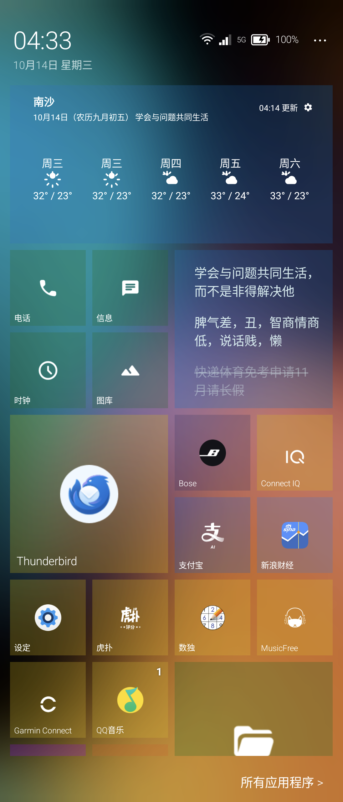
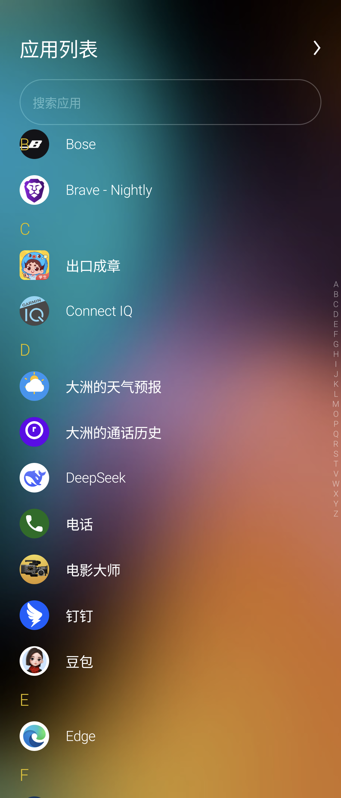
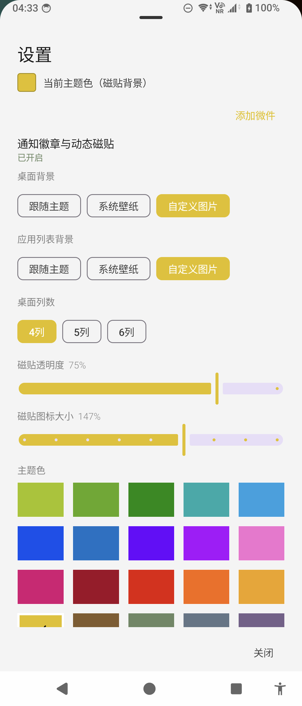
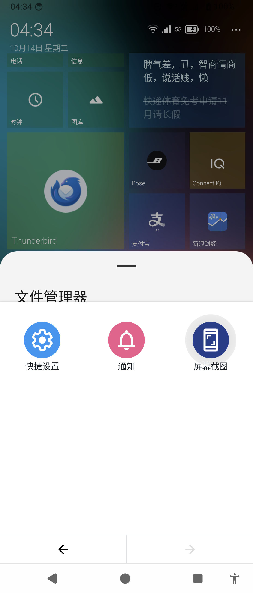

# MyLauncher10

A Windows Phone 10 style home screen launcher for Android. Classic Metro tiles, modern Android.

- 100% Jetpack Compose, no third-party UI libraries
- English & Chinese (follows system language)
- APK-only releases — no accounts, no tracking, no network calls of its own

## Screenshots

| | | |
|:---:|:---:|:---:|
|  |  |  |
|  | | |

## Features

### Tiles

- Classic Metro tiles in three sizes — small, medium, wide
- Positioned grid with optional gaps; 4 / 5 / 6 columns
- Drag to rearrange — neighbors shift aside or push down automatically
- Long press for jelly wobble: release in place to edit, drag to move, drop on a folder to file
- Per-tile custom colors
- Merge tiles into folders, move apps in and out, dissolve folders

### Widgets

- Full AppWidget support: pick, bind, configure, resize
- Widget gestures match tiles: long press to edit, swipe hands off to home screen scrolling
- Scrollable widgets (calendars, reminders) scroll independently without fighting the home screen

### Personalization

- Accent color picker — always shows the active color
- Global tile transparency and icon size
- Backgrounds: solid black / system wallpaper / custom image with adjustable blur
- Smart icon rendering: rich icons keep their colors, flat icons become white silhouettes (WP style) — auto or manual per tile

### Status & System

- Live clock, date, battery, network type (5G / 4G / Wi-Fi), Bluetooth
- Notification badges on tiles
- App drawer (swipe up at the top), app shortcuts, app info, uninstall
- Smooth inertial scrolling with rubber-band overscroll and jelly bounce

## Requirements

- Android 8.0+

## Permissions

All optional — the launcher works without any of them:

| Permission | Purpose |
| --- | --- |
| Notification access | Badges on tiles |
| Phone state | Network type in the status area |
| Bluetooth | Bluetooth icon in the status area |

## Download
